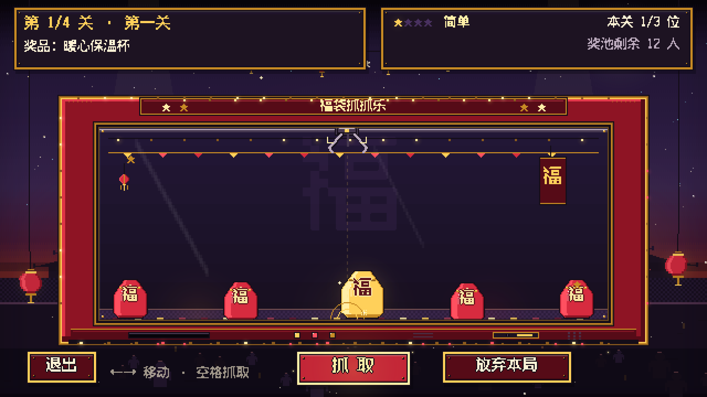
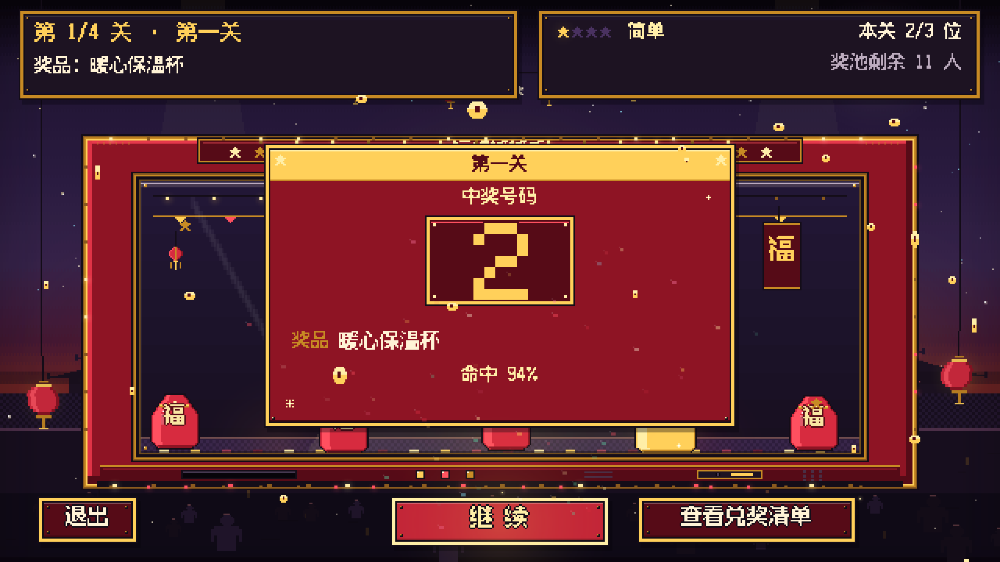
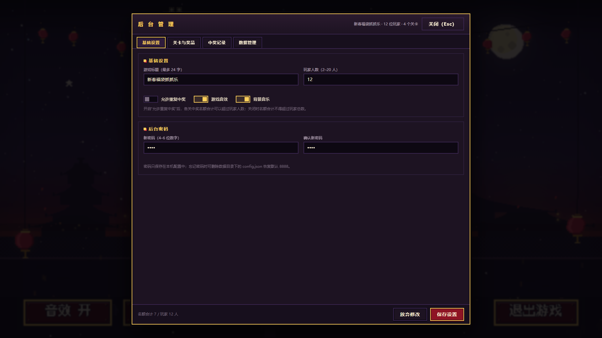

# 新春福袋抓抓乐


一款为年会现场准备的 Windows 像素风抽奖小游戏：640×360 像素画面 + DOM 弹层，离线运行、没有外部图片/音频资源，开箱即用。

- 玩家每人一个数字序号，凭号码兑奖；默认中奖者移出奖池，不会重复中奖。
- 1–8 个关卡，每关可单独设置奖品、中奖人数与难度（简单 / 普通 / 困难 / 极限）。
- 抓娃娃机玩法：移动爪子抓金福袋，命中即揭晓中奖号码；也可由主持人直接操作流程。
- 后台管理：人数与奖品设置、兑奖清单勾选、CSV 导出、A4 兑奖单打印、数据备份。
- 便携版数据保存在 exe 同目录的 `data/` 文件夹，拷走整个文件夹即可换电脑使用。

> English: A pixel-art Spring Festival lottery mini-game for company annual parties. Windows portable exe, 2–20 numbered players, configurable prize levels and difficulty, claw-machine draw, admin panel, CSV/print — fully offline.

**GitHub：** https://github.com/LiZhiYi7/cny-fudai-lottery

## 效果预览

| 首页 | 抓取 |
| --- | --- |
|  |  |

| 开奖 | 后台管理 |
| --- | --- |
|  |  |

---

## 快速开始

### 方式一：双击 exe（年会现场推荐）

1. 从 GitHub Releases 下载，或自行运行 `npm run build:win` 生成 `dist/新春福袋抓抓乐-1.0.0-portable.exe`（文件名随版本号变化）；把它复制到一个普通文件夹（例如 `D:\年会抽奖\`）再双击。若在受限目录（某些同步盘、沙箱工作区）里直接运行出现 `NSIS Error`，就是该目录权限所致，复制出来即可。
2. 双击运行。首次启动会把程序解压到临时目录，可能比平时慢几秒，属正常现象。
3. 启动后即进入首页；按 `F11` 或点首页「全屏 F11」进入全屏。
4. 数据保存在 exe 同目录的 `data/` 文件夹（首次运行自动创建）。
5. 建议把 exe 放到一个独立文件夹（例如 `D:\年会抽奖\`），把 `data/` 一起备份，不要只拷 exe。

> 便携版没有代码签名，Windows SmartScreen 可能提示「已保护你的电脑」。点「更多信息」→「仍要运行」即可。详见文末常见问题。

### 方式二：源码运行 / 浏览器预览

需要 Node.js 18 或更高版本。

```bash
npm install          # 安装依赖（首次需要联网）
npm run dev          # 启动本地静态服务器
# 浏览器打开 http://127.0.0.1:5180/index.html 预览
npm start            # 或者用 Electron 窗口运行（与 exe 行为一致）
```

浏览器模式下数据存在 `localStorage`，没有「打开数据目录」能力；正式使用请用 Electron / exe。

### 常用命令

| 命令 | 说明 |
| --- | --- |
| `npm run dev` | 本地静态服务器（默认 5180 端口） |
| `npm start` | 以 Electron 窗口启动 |
| `npm test` | 单元测试（`node --test "tests/unit/*.test.mjs"`） |
| `npm run test:e2e` | Playwright + 本机 Chrome 的端到端流程测试（需 `npm install`） |
| `node scripts/qa-shots.mjs` | 截取关键界面到 `preview/qa/`，用于人工巡检 |
| `npm run build:win` | 重新打包 Windows 便携版 exe |

---

## 后台管理

- 入口：首页右下方的「后台管理」按钮（兑奖清单在首页 / 终场 / 游戏中均可打开）。
- 默认密码：`8888`。密码为 **4–6 位数字**，建议在第一次使用前改成现场专属密码。
- 后台可完成：
  - 游戏标题、玩家人数（2–20）、是否允许重复中奖、音效 / 背景音乐、后台密码；
  - 关卡与奖品编辑（1–8 关）：关卡名称、奖品名称、中奖人数、难度，支持增删与排序；
  - 实时校验：人数、名额、文本长度、密码格式不合法时给出中文提示；
  - 中奖记录与兑付勾选、导出 CSV、打印兑奖单、配置导入导出、打开数据目录、重置数据。

### 设置一场年会的完整步骤

1. 首页 →「后台管理」→ 输入密码。
2. 填写游戏标题（≤ 24 字），选择玩家人数（2–20，即现场参与抽奖的人数编号总数）。
3. 逐个编辑关卡（1–8 关）：
   - 关卡名称（≤ 20 字，例如「第一关」「特等奖」）；
   - 奖品名称（≤ 30 字，会显示在揭晓和兑奖单上）；
   - 本关中奖人数（≥ 1，且不超过玩家人数）；
   - 难度：简单 / 普通 / 困难 / 极限，影响爪子速度、摆动、金福袋宽度与福袋数量。
4. 注意名额合计：所有关卡中奖人数之和不能超过玩家人数；若确实要「一人中多奖」，开启「允许重复中奖」。
5. 保存配置 → 回到首页 →「开始抽奖」。
6. 名单页核对「本轮玩家 · N 位」与关卡奖品，按空格或点「开始抓取」。
7. 每关揭晓后按「继续」进入下一关；全部关卡结束后进入终场。
8. 终场或首页打开「查看兑奖清单」，凭号码兑奖并勾选「已兑付」。

---

## 现场流程建议

- **提前一天彩排**：用同一台电脑、同一个 exe、同一个数据目录跑一遍完整流程，确认人数、奖品、名额都正确。
- **全屏**：`F11` 切换全屏；建议分辨率 1920×1080 或 1280×720，画面会等比居中显示（内部固定 640×360 像素）。
- **关掉干扰**：关闭屏保、系统通知、微信/QQ 弹窗，避免开奖时被遮挡。
- **名单核对**：开抽前在名单页清点人数，并把号码牌发给对应员工。
- **节奏控制**：主持人可在揭晓后停顿几秒再按「继续」；倒计时页面点「跳过倒计时」可直接开始。
- **兑奖**：终场打开兑奖清单，一人兑付后勾选一次；勾选会立即保存，误关页面也不会丢。
- **收尾**：关闭程序后把 `data/` 文件夹整体备份（例如复制到 U 盘或网盘）。

---

## 兑奖清单 / CSV / 打印

- **兑奖清单**：列出序号、关卡、奖品、中奖号码、抽取时间、兑付状态；勾选复选框即标记「已兑付」，自动保存。
- **导出 CSV**：文件带 UTF-8 BOM、CRLF 换行，Excel 打开不乱码；含逗号、引号、换行的奖品名会自动转义。
- **打印兑奖单**：生成 A4 纵向兑奖单（关卡 / 奖品 / 中奖号码 / 兑付勾选栏 / 签字栏），使用系统打印对话框打印。
- 浏览器模式下「导出 CSV」走浏览器下载；Electron / exe 下会弹出保存对话框。

---

## 数据位置与备份

| 运行方式 | 数据位置 |
| --- | --- |
| 便携 exe | exe 同目录的 `data\`（优先）；若该目录不可写，退回 `%APPDATA%\新春福袋抓抓乐\data\` |
| 源码 `npm start` | 项目根目录的 `data\` |
| 浏览器预览 | 浏览器 `localStorage`（键名前缀 `cnyfudai:`） |

`data/` 目录中的文件：

- `config.json`：人数、关卡、奖品、密码等配置；
- `results.json`：当前 / 最近一局的中奖记录与兑付状态；
- `archive/`：被新对局顶替下来的历史对局；
- `state.json`：窗口大小与位置。

**备份**：关闭程序后，复制整个 `data/` 文件夹即可。恢复时把备份的 `data/` 覆盖回 exe 同目录。
**注意**：不要只备份 exe——抽奖记录和配置都在 `data/` 里。

---

## 常见问题

**Q：双击 exe 出现 SmartScreen「Windows 已保护你的电脑」？**
A：程序没有购买代码签名证书，属正常提示。点「更多信息」→「仍要运行」。如果公司电脑禁止运行未知程序，需要 IT 放行或改用源码 `npm start` 运行。

**Q：首次启动很慢 / 杀毒软件报警？**
A：便携版首次启动要先解压到临时目录，慢几秒是正常的；个别杀软会扫描便携包，加入信任即可。之后启动会快很多。

**Q：没有声音？**
A：先点一下游戏画面（浏览器/Electron 需要一次交互才允许播放音频），再检查首页左下角「音效 开/关」以及系统音量；后台里「音效 / 背景音乐」开关也要打开。

**Q：不小心点了「开始新一局」，旧记录会丢吗？**
A：不会。开始新一局前，旧对局会自动归档到 `data/archive/`（兑奖清单也仍可查看历史记录）。但归档文件不参与当前兑奖清单，请及时导出 CSV 或打印。

**Q：误删了 `data/` 怎么办？**
A：程序会重新生成默认配置；历史中奖记录无法恢复，因此务必定期备份 `data/`。如果只是配置写坏，可删除 `data/config.json` 让程序恢复默认配置。

**Q：忘记后台密码？**
A：用记事本打开 `data/config.json`，把 `"pin": "...."` 改成 `"8888"` 后重新打开程序（注意保持 JSON 格式合法）。浏览器模式可在开发者工具里清除 `cnyfudai:config.json`。

**Q：画面模糊 / 有黑边？**
A：游戏内部固定 640×360 像素并按整数倍像素化显示，窗口不是 16:9 时会有黑边；按 `F11` 全屏即可。请不要用系统缩放强行拉伸。

**Q：能否同时开两个窗口？**
A：Electron 版为单实例运行，重复启动会激活已有窗口；浏览器预览可以开多个标签页，但 localStorage 数据共享。

---

## 重新打包

```bash
npm install              # 安装 electron / electron-builder 等依赖
npm run icon             # 可选：重新生成 build/icon.ico（需要 Python 与 Pillow）
npm run build:win        # electron-builder 打包 Windows 便携版
```

产物在 `dist\` 目录，文件名形如 `新春福袋抓抓乐-1.0.0-portable.exe`。
打包前建议先跑 `npm test` 与 `npm run test:e2e`；打包后按 [tests/SMOKE.md](tests/SMOKE.md) 做 exe 冒烟检查。
exe 只打包 `electron/`、`src/` 与 `package.json`（见 package.json 的 `build.files`），测试、预览截图、`sandbox.html` 等开发文件不会进入安装包。

---

## 字体与第三方资源

- 内置像素字体：`src/assets/fonts/fusion-pixel-12px-zh_hans.woff2`（Fusion Pixel Font 12px，SIL Open Font License 1.1，许可证文本见同目录 `OFL.txt`）。
- 字体随程序本地打包，**不发起任何网络请求**；游戏图形（背景、抓娃娃机、福袋、爪子、奖卡、粒子特效）全部由 Canvas 程序化绘制，不使用外部图片或音频文件。
- 若字体加载失败（例如被安全软件拦截），像素文字会自动回退到系统中文字体，功能不受影响。
- 这与“离线可用 / 不依赖外部资源”的验收口径不冲突：字体是内置在安装包里的本地资源，断网也能正常显示。

---

## 目录结构

```text
├─ electron/           Electron 主进程与 preload（自定义 app:// 协议、数据目录、IPC）
├─ src/
│  ├─ index.html       页面入口（画布 + DOM 叠层）
│  ├─ styles.css       全局样式、兑奖清单、打印样式
│  ├─ styles-admin.css 后台管理样式
│  ├─ assets/          内置像素字体与 favicon（本地资源，无网络请求）
│  └─ js/
│     ├─ main.js       渲染进程入口
│     ├─ core/         纯逻辑：常量 / 校验 / 对局状态 / 随机 / CSV / 存储适配
│     ├─ game/         游戏外壳：App、屏幕、抓娃娃机、音效、兑奖清单
│     ├─ render/       640×360 像素渲染：引擎、绘图、特效、像素文字
│     └─ admin/        后台管理面板（DOM）
├─ sandbox.html        美术素材自检页（15 个 640×360 画布，不参与 exe 打包）
├─ scripts/            静态服务器、打包、图标、截图脚本
├─ tests/
│  ├─ unit/            单元测试（node:test）
│  ├─ e2e/             端到端测试（Playwright-core + 本机 Chrome）
│  └─ SMOKE.md         打包后 exe 冒烟检查清单
├─ preview/qa/         截图巡检输出（本地生成，不提交）
├─ docs/               渲染契约与 README 截图
└─ LICENSE             MIT 许可证
```

---

## 测试

```bash
npm test                    # 单元测试：校验 / 状态 / CSV / 随机 / 难度参数
npm run test:e2e            # E2E：配置→开奖→兑付→刷新恢复→非法配置拦截
node tests/e2e/admin.mjs    # 后台 E2E：PIN 门禁/锁定→页签/关卡编辑→保存回读→记录兑付/CSV→重置/恢复默认→960 窄窗口
node scripts/qa-shots.mjs   # 截图：home / roster / intro / play / reveal / finale / sheet / admin
                            # 以及 admin-panel、四个页签、960 窄窗口、2 人 / 20 人布局、sandbox.html 素材总览
```

- E2E 需要本机安装 Chrome（脚本默认用 `channel: 'chrome'`，也可通过 `CHROME_PATH` 指定 exe）。
- 截图输出在 `preview/qa/`，包含 2 人 / 20 人名单与首页、后台面板、`sandbox.html` 素材总览（15 个 640×360 画布），用于人工检查布局与素材。
- 打包后的 exe 检查项见 [tests/SMOKE.md](tests/SMOKE.md)。

当前回归结果（本版本）：

| 脚本 | 规模 | 结果 |
| --- | --- | --- |
| `npm test`（单元测试） | 55 tests | 55 通过 / 0 失败 |
| `node tests/e2e/run.mjs` | 14 项流程检查 | 14 通过 / 0 失败 |
| `node tests/e2e/admin.mjs` | 10 项后台检查 | 10 通过 / 0 失败（无 pageerror） |
| `node scripts/qa-shots.mjs` | 15 项截图巡检（生成 16 张 PNG） | 15 通过 / 0 失败（15 个素材画布均有绘制） |

> 以上结果需在装有 Chrome 的 Windows 机器上重新运行确认；回归日志在 `preview/qa/*.log`。

---

## 许可

- **源代码**：MIT License，见 [LICENSE](LICENSE)。
- **内置字体**：Fusion Pixel Font 12px，SIL Open Font License 1.1，见 [src/assets/fonts/OFL.txt](src/assets/fonts/OFL.txt)。
- 角色、场景、福袋、娃娃机、粒子等美术均由 Canvas 代码程序化绘制，不使用外部图片或音频。
